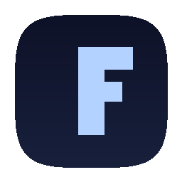

<p align="center">
  
</p>

<h1 align="center">FloatPad</h1>

<p align="center">
  A lean, always-on-top reference pad for macOS.<br/>
  Image board, video player, real web browser and writing pad — in one floating overlay.
</p>

<p align="center">
  <a href="https://github.com/Asef0Gondal/floatpad"></a>
  
  
  
  
  
  <a href="https://github.com/Asef0Gondal/floatpad/actions/workflows/ci.yml"></a>
  
</p>

---

> FloatPad came into existence for one simple reason: **I needed it.** As a creative director, I got tired of alt-tabbing away from my work every time I had to check a reference — so I built myself an always-on-top pad that keeps everything in view. That's the entire origin story.
>
> **🦀 v2 is the Rust rewrite.** The shell is now [Tauri 2](https://tauri.app) — a native Rust core instead of Electron, same React UI, ~10 MB app instead of ~250 MB. macOS is the primary platform; Windows and Linux build from the same codebase. The original Electron shell still runs (`npm run start:electron`) while the port settles.

## Why FloatPad

Reference material is scattered across Finder, YouTube, browser tabs and design files. Every lookup costs an alt-tab, a window resize, and a lost train of thought.

FloatPad keeps the reference **on top of everything else**: a frameless overlay that stays above your work, can drop to **15% opacity**, and can become **click-through** so it never blocks the app underneath. It lives in the menu bar instead of the Dock and is summoned with a global shortcut.

Built for video editors, designers and developers who need a second screen that never takes focus away from the main one.

## Modes

| Mode | What it does |
| --- | --- |
| **Board** | Infinite canvas for images, annotations, sticky notes and screenshots |
| **Video** | Local files or direct URLs, with A-B loop, frame stepping and frame grabbing |
| **Web** | A real Chromium browser with bookmarks, reader mode and image-to-Board actions |
| **Write** | Screenplay-format or Markdown writing pad with autosave and a focus timer |

### Board

- Drop images from Finder, drag them from a browser, or paste with `⌘V`
- Scroll / pinch to zoom toward the cursor, drag to pan, `⌘0` to zoom to fit
- Annotation tools: pen, eraser, rectangle, ellipse, arrow, text, and a pixel eyedropper
- Adjustable stroke color and width, per-image opacity, bring-to-front / send-to-back
- Double-click empty space to add a sticky note; select multiple images with `⇧`-click or rubber-band
- Drag an image out to Finder / Figma using the corner handle
- Save and reload boards as `.floatpad` files; export the whole board as PNG or JPEG
- Capture any screen region with `⌘⇧S` and drop it straight onto the board

### Video

- Open a local video file or paste a direct video URL
- Full transport: play/pause, seek, volume, mute, frame-by-frame stepping, `0.25×–2×` speed
- **A-B loop** for repeating a section while following along
- **Grab frame → Board** to keep a still reference next to your work
- Picture-in-Picture support
- Pauses automatically when the tab is hidden or a CPU-heavy task needs the resources

### Web

- Embedded Chromium (`webview`) — YouTube, documentation, Notion and most sites work normally
- URL bar with back / forward / reload, plus persistent bookmarks (`⌘D`, `⌘1–9`)
- **Reader mode** strips page clutter for long-form reading
- **Ad and tracker blocking** at the session level, with a per-site allowlist toggle
- Right-click any image to send it to the Board
- Step through embedded video frame-by-frame and grab a frame to the Board

### Write

- **Screenplay mode**: `Tab` cycles element types — SCENE → Action → CHARACTER → Dialogue → (parenthetical) — with automatic uppercase scene headings
- **Markdown / freeform mode** for notes and drafts
- Live word/page statistics, autoreload of the last document, and autosave to local storage
- Open and save `.txt`, `.md` and Fountain files through native dialogs
- Built-in 25-minute focus timer

## Window & workflow

- **Always on top**, visible on every Space, including full-screen apps
- **Opacity** slider from 100% down to 15%
- **Detach** toggles click-through, with mouse events forwarded to the window underneath
- **Mini mode** collapses the window to its title bar for a near-invisible strip
- **Window sizes**: Tiny `400×320`, Small `580×440`, Medium `700×560`, Large `960×700`, Wide `1100×620`
- **Standalone panels**: undock any mode into its own floating window and dock it back later
- **Dark / light themes** with the choice persisted
- **Potato mode** cuts rendering work for low CPU/VRAM use while gaming or rendering
- **Menu-bar app**: closing hides the window instead of quitting; `⌘⇧Space` brings it back
- **`⌘⇧Space` is also a panic key**: it dismisses the screenshot overlay and restores click control if the window is detached, then toggles visibility
- Window position and size are remembered across launches

## Keyboard shortcuts

| Global | |
| --- | --- |
| `⌘⇧Space` | Show / hide FloatPad |
| `⌘⇧S` | Screenshot a screen region → Board |

| Board | |
| --- | --- |
| Scroll / pinch | Zoom toward cursor |
| Drag canvas | Pan |
| Double-click | Add sticky note |
| `⌘V` | Paste image |
| `⌘A` | Select all |
| `⇧`-click / drag | Add to selection / rubber-band |
| `⌫` | Delete selected |
| `⌘0` | Zoom to fit |
| Corner handle | Drag image out to Finder / Figma |

| Video | |
| --- | --- |
| `Space` | Play / pause |
| `←` `→` | Seek ±5s |
| `↑` `↓` | Volume ±5% |
| `M` | Mute |
| `,` `.` | Step one frame |
| `A` / `B` | Set A-B loop points |
| `⊡` | Grab frame → Board |

| Web | |
| --- | --- |
| `⌘L` | Focus URL bar |
| `⌘D` | Bookmark page |
| `⌘1–9` | Jump to bookmark |
| Right-click image | Send to Board |

Press `?` anywhere in the app for the full shortcut overlay.

## Architecture (v2 — Rust/Tauri)

FloatPad is a Tauri 2 app: a native Rust core with the system webview rendering the React UI.

- **Rust core** — `src-tauri/src/`: window and panel lifecycle, tray, global shortcuts, opacity/click-through/all-Spaces via platform APIs (`objc2` on macOS, `windows-sys` on Windows), screen capture through `xcap`, persisted window bounds in `prefs.json`, ad-block allowlist.
- **Embedded browser** — Web mode is a native child webview (Tauri multi-webview) positioned over the app's content area; a main-frame-only injected script reports SPA navigations, context menus and popups back to the shell and hides ad/tracker elements.
- **Renderer** — React 18 + Vite 5 in `src/`, unchanged from v1: a single `App` shell owns mode switching, themes, opacity, mini/standalone state; each mode is a self-contained component under `src/modes/`.
- **IPC** — `src/ipc.js` is a dual-backend shim: it speaks Tauri `invoke`/`listen` in v2 and Electron `ipcRenderer` in v1, so every mode keeps the same channel names. File dialogs and file I/O go through the official `dialog`/`fs` plugins; everything window-related is a Rust command.
- **Panel windows** — undocked modes are separate Tauri windows loading the same bundle with `?panel=<mode>`.
- **Persistence** — window prefs and the ad-block allowlist live in `prefs.json` under the app config dir; board documents are `.floatpad` files; the Write pad, bookmarks and theme autosave to `localStorage`.

### Known differences from the Electron v1

- **Drag image out to Finder/Figma** is not wired up yet (Electron's `startDrag` has no Tauri core equivalent).
- **Ad blocking** hides ad/tracker elements and removes ad iframes instead of cancelling network requests (WKWebView exposes no request interceptor); the per-site allowlist works the same.
- **Detach (click-through)** does not forward hover events to the window underneath.
- **Window opacity** is macOS/Windows only for now (no-op on Linux).

## Project structure

```
floatpad/
├── assets/                 # app + tray icons
├── public/
│   ├── electron.js         # legacy Electron main process (v1 shell)
│   └── screenshot.html     # full-screen region-capture overlay (both shells)
├── src/
│   ├── ipc.js              # dual-backend IPC shim (Tauri / Electron)
│   ├── components/         # Icons, Onboarding, ShortcutsOverlay
│   ├── modes/              # ImageBoard, VideoPlayer, Browser, Write
│   ├── utils/              # helpers + Tauri webview adapter
│   ├── theme.js            # dark / light theme application
│   ├── App.jsx             # window shell, modes, titlebar
│   ├── App.css             # all UI styling
│   └── index.jsx           # React entry point
├── src-tauri/
│   ├── src/                # Rust core: lib, commands, platform shims, page.js
│   ├── capabilities/       # per-window IPC permissions
│   ├── icons/              # generated bundle icons
│   └── tauri.conf.json
├── index.html
├── vite.config.js
└── package.json
```

## Getting started

**Requirements:** Node.js 18+ (20 LTS recommended — see `.nvmrc`), Rust stable ([rustup](https://rustup.rs)), and the Tauri platform prerequisites:

- **macOS:** Xcode Command Line Tools (`xcode-select --install`)
- **Windows:** WebView2 (preinstalled on 10/11) + MSVC build tools
- **Linux:** `libwebkit2gtk-4.1-dev`, `libgtk-3-dev`, `libayatana-appindicator3-dev`, `librsvg2-dev`, `libxdo-dev` (see the CI workflow for the full apt line)

```bash
# Install dependencies
npm install

# Run the Rust/Tauri app (hot reload)
npm run dev
```

The legacy Electron shell still works: `npm run start:electron`.

## Build & package

```bash
# Production frontend build → dist/
npm run build

# Native app bundles (runs the Rust release build)
npm run dist:mac      # .app + .dmg  → src-tauri/target/release/bundle/
npm run dist:win      # NSIS installer
npm run dist:linux    # .deb + AppImage
```

Screen capture (⌘⇧S and frame grabbing) needs the OS **Screen Recording** permission on macOS; the system prompts on first use.

## Data & privacy

FloatPad runs entirely on your machine. There is no account, no telemetry and no analytics. Network traffic only happens inside the embedded browser when you navigate to a page, and ad/tracker hosts are blocked there by default.

## Repository notes

- `dist/`, `node_modules/` and `src-tauri/target/` are ignored; only sources are committed.
- Every push to `main` runs CI (`.github/workflows/ci.yml`): the Vite bundle plus `cargo check` on macOS, Windows and Linux.
- The Electron v1 shell (`public/electron.js`, `npm run start:electron`) is kept until the Tauri port reaches full parity, then it gets deleted.
- `FP_SELFTEST=1 cargo run` (from `src-tauri/`, with vite running) executes a hidden end-to-end check of the window/panel/webview/capture plumbing — no window is shown.

## License

[MIT](LICENSE) © 2026 Asif Gondal